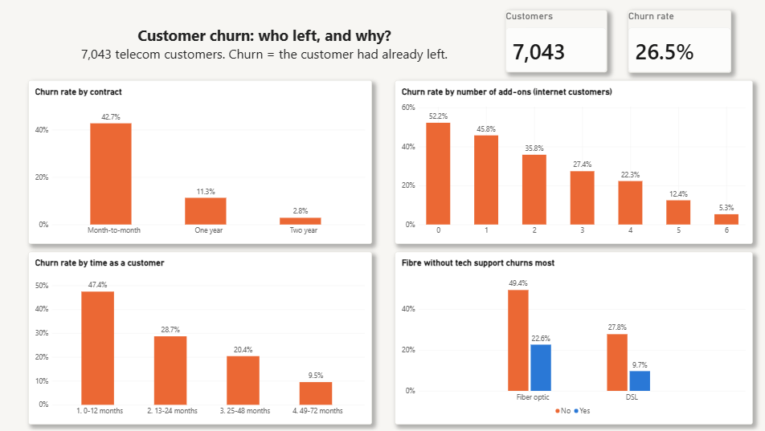
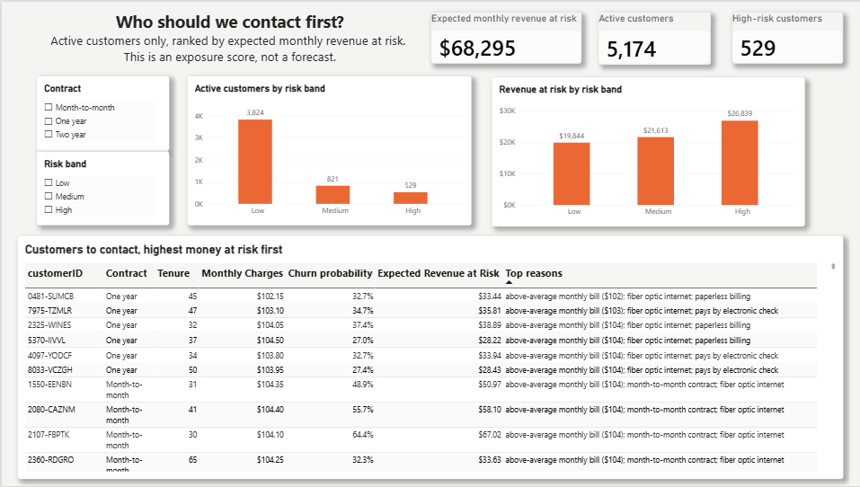
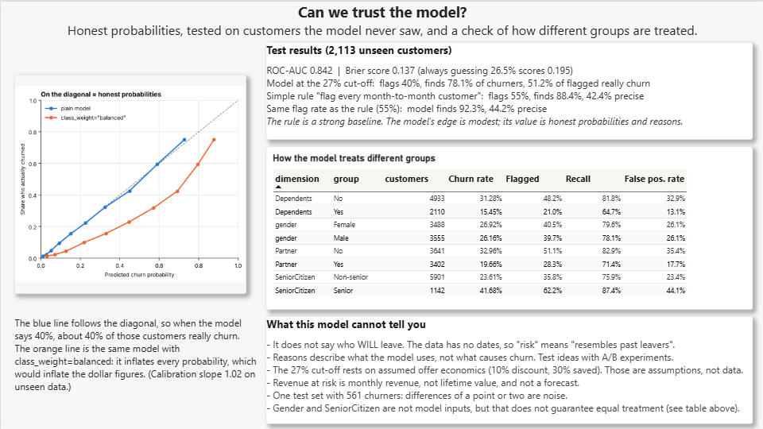

# Explainable Churn Predictor

> **Status:** The three-page Power BI dashboard is finished.

## Why this project

I had a free Spotify account that I had not opened for about two years. When I finally logged back in, the app welcomed me
back and offered a month of Premium for free, so my listening would not be interrupted. That is not churn prediction (I was
a dormant free user, not a paying subscriber, and I do not know how Spotify chose to send it), but it is the same kind of
problem: companies notice customers who have gone quiet and try to bring them back with an offer. This project looks at the
step before that: spotting customers who resemble past leavers while they are still active, and asking which of them are
worth an offer, and why.


## Questions this project answers

1. Which customer segments churn most, and how much monthly revenue is exposed?
2. Can a simple model's probabilities be trusted (are they calibrated)?
3. Can every prediction come with a plain-language reason someone can act on?
4. Does the model treat groups (gender, seniors, household status) similarly?

## How it works

```
Raw Telco CSV
   -> clean.py                   -> telco_clean.csv   -> SQLite + SQL profiling (sql_profile.py)
   -> split.py (70/30, seed 42)  -> train.csv / test.csv
   -> notebooks/02  explore the TRAINING data, decide what the model may use
   -> notebooks/03  logistic regression in one sklearn Pipeline; check calibration; choose cut-off; grade once on test
   -> notebooks/04  SHAP reasons, out-of-fold scores for everyone, fairness table  -> telco_predictive_scores.csv
   -> Power BI dashboard (reads the scores and fairness CSVs)       -> (optional) thin Streamlit app
```

## Repo layout

```
churn-explainer/
├── data/            raw and processed data, SQLite database
├── sql/             SQL profiling queries
├── src/             scripts: clean.py, sql_profile.py, split.py, modeling.py (the model recipe), check_env.py
├── notebooks/       02_eda_train, 03_model, 04_explain_and_score
├── models/          the saved pipeline and its settings
├── docs/            EXPLAIN_IT.md (study guide), data_dictionary.md, SQL results, fairness table, figures
├── dashboard/       Power BI file, data copies, screenshots
└── README.md
```

## Quick start (Windows PowerShell)

```powershell
py -3.12 -m venv venv              # Python 3.12 is a safe choice for shap
.\venv\Scripts\Activate.ps1
pip install -r requirements.txt
python src\check_env.py

# Download "Telco Customer Churn" (blastchar) from Kaggle and save it as:
#   data\raw\WA_Fn-UseC_-Telco-Customer-Churn.csv

python src\clean.py                # tidy the data
python src\sql_profile.py          # SQL profiling
python src\split.py                # 70/30 split -> train.csv / test.csv
# Then run the notebooks in order (pick the venv as the kernel):
#   notebooks\02_eda_train.ipynb  ->  03_model.ipynb  ->  04_explain_and_score.ipynb
```

## Dashboard (Power BI)

Three pages: who churns, who to contact first, and whether the model can be trusted.

| 1. Who churns? | 2. Who to contact first? | 3. Can we trust the model? |
|---|---|---|
|  |  |  |

Open `dashboard/churn_dashboard.pbix` in Power BI Desktop (free, Windows). It reads the two CSVs in `dashboard/data/`.

## Key results

**Test set (2,113 customers the model never saw).** Terms: *recall* = share of real churners flagged; *precision* = share of flagged customers who really churned.

| | Customers flagged | Recall | Precision |
|---|---|---|---|
| Always predict "no churn" | 0% | 0% | n/a |
| Rule: flag every month-to-month customer | 55% | 88.4% | 42.4% |
| **Model at the 27% cut-off** | **40%** | **78.1%** | **51.2%** |
| Model, flagging the same number as the rule | 55% | 92.3% | 44.2% |

- ROC-AUC **0.842**, Brier score **0.137** (always guessing 26.5% scores 0.195), calibration slope **1.02** on unseen data.
- A simple contract rule is a strong baseline. The model's edge is real but modest; its value is *honest probabilities* and *per-customer reasons*.
- **Honest probabilities:** `class_weight="balanced"` would have lifted the average predicted churn rate from the true 26.5% to about 42%.
- **Cut-off (27%)** comes from a stated cost trade-off (a 10% discount that saves 30% of would-be churners). Both numbers are assumptions; the method is the point.

**Revenue at risk (active customers).** Expected monthly revenue at risk (churn probability x monthly charges) is **$68,295, 21.5% of the $316,986** active customers pay.
The 529 High-risk customers (10% of active customers) hold **39%** of it. This is an exposure score, not a forecast.

**Fairness.** Gender (not a model input) is treated almost identically (recall 79.6% vs 78.1%). Seniors (also not an input) are flagged much more often
(62% vs 36%) with nearly twice the false-positive rate (44% vs 23%). Dropping a column does not guarantee equal treatment, which motivates Project 3.

## What the data says and what I would try

From the SQL profiling and the model (correlations, not proven causes):

- 26.5% of customers have churned, and they account for 30.5% of monthly revenue.
- **Contract:** month-to-month 42.7% vs one-year 11.3% vs two-year 2.8%.
- **Tenure:** 47.4% churn in the first year vs 9.5% after four years.
- **Fibre without tech support** churns at 49.4%, vs 22.6% for fibre customers who have it.
- **Electronic check** payers churn at 45.3%, vs 16.0% for customers on automatic payment.
- **Add-ons:** 52.2% churn with none, 5.3% with all six (internet customers).

Ideas to test (as A/B tests, because customers choose contracts and payment methods for their own reasons):
1. Focus first on **new month-to-month customers**, the largest high-churn group.
2. Offer an **incentive to move from month-to-month to a longer contract**.
3. Trial **bundled tech support for fibre customers**.
4. **Nudge electronic-check payers to automatic payment.**
5. Rank outreach by **expected revenue at risk**, and review the offer rule for seniors, who get many unneeded discounts.

## Common doubts (plain language)

**What is logistic regression?** A simple model that gives each feature a weight, adds them up, and turns the total into a probability between 0 and 1.
Every weight can be read directly, which is why it is easy to explain.

**What is SHAP?** A way to split one customer's risk into pushes from each feature, starting from the average customer. "Month-to-month contract: +0.5" means that
feature raised this customer's risk compared with an average customer.

**What does "calibrated" mean, and why check it?** When the model says 30%, about 30% of those customers should really churn. I check it because the revenue-at-risk number multiplies
probability by money; inflated probabilities would inflate the number.

**Why not XGBoost or a random forest?** A simple model is easier to explain, and the aim here is trust and explanation rather than the last point of accuracy. Comparing models is a possible extension.

**You left out gender, so is it fair?** Not automatically: other columns can stand in for it. That is why the fairness table measures outcomes by group instead of assuming.

**Is "revenue at risk" a forecast?** No. The data has no time window. It is the expected monthly revenue sitting with customers who resemble past churners.

## Limitations

- Snapshot data with no time dimension: `Churn = Yes` means the customer *already left*, so scores describe "customers who resemble past churners", not next quarter.
- SHAP and the reasons describe what the **model** uses, not what **causes** churn.
- The offer economics (10% discount, 30% saved) are assumptions, not data. Real uplift would need an A/B test.
- One test set with 561 churners: differences of a point or two are noise. No formal significance test was run.
- Revenue at risk is monthly revenue, not customer lifetime value.
- Fairness is measured on four groups; dropping `gender` and `SeniorCitizen` as inputs is a design choice, not a guarantee.
